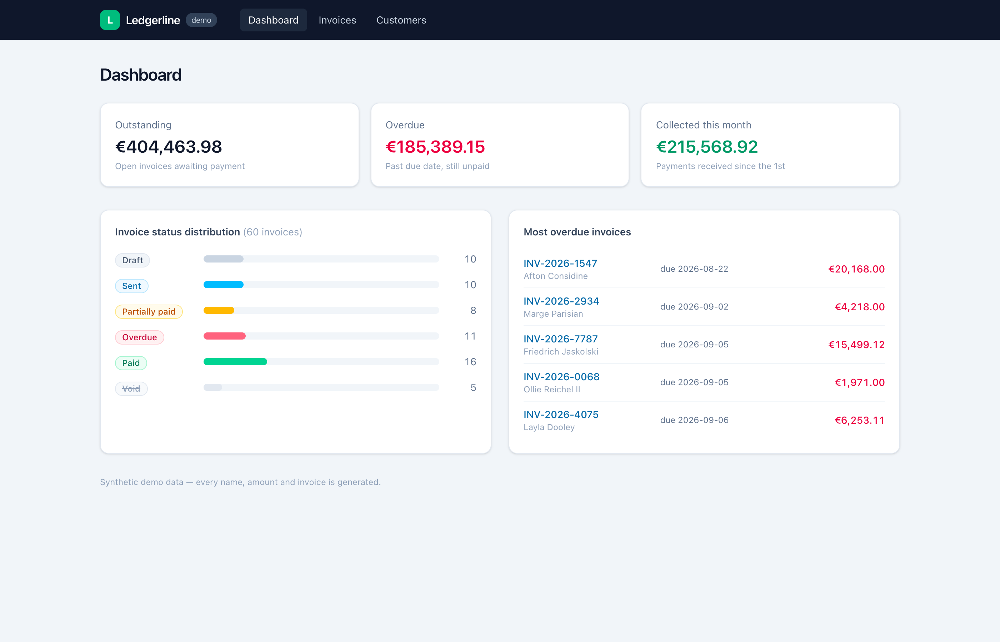
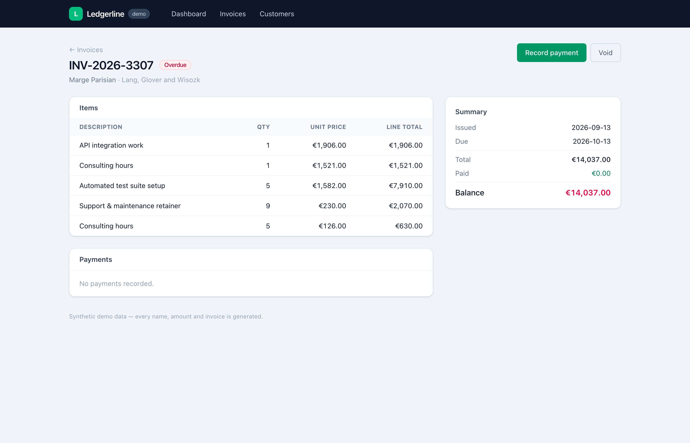
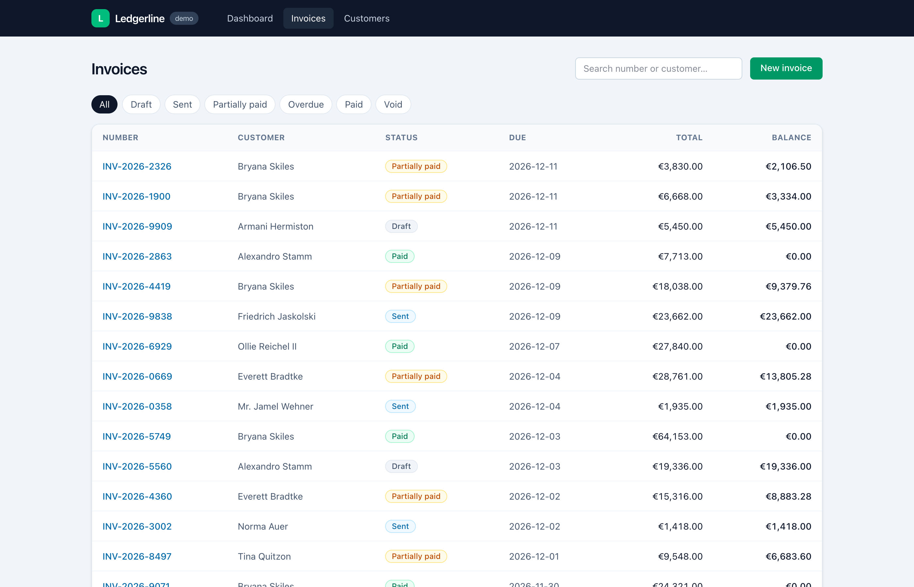
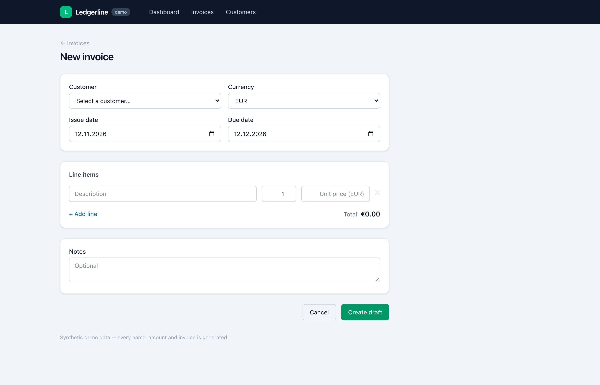
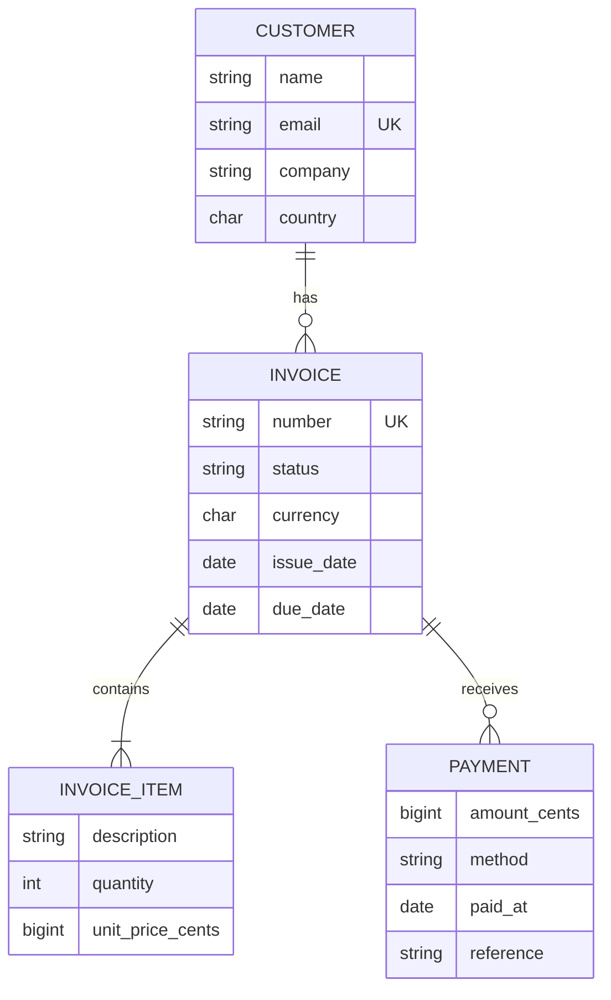

# Ledgerline — Laravel + Vue billing demo


A small invoicing & payments dashboard — **Laravel 13 REST API + Vue 3 SPA** — built from scratch as a clean, reviewable demonstration of how I structure a PHP/Laravel application: an explicit domain layer, an enforced invoice state machine, integer-cents money handling, and a test suite that actually exercises the business rules.

All data is synthetic (Faker). No real customers, amounts or companies anywhere.

| Dashboard | Invoice detail |
|---|---|
|  |  |

| Invoice list & filters | New invoice |
|---|---|
|  |  |

## What it does

- **Customers** — searchable, paginated CRUD; deletion is blocked while invoices exist.
- **Invoices** — drafts with line items, sequential numbers (`INV-2026-0001`), a lifecycle (`draft → sent → partially paid → paid`, plus `void`), list filters including a *derived* overdue view, full-text search.
- **Payments** — recorded against open invoices; partial payments move the invoice to `partially_paid`, settling it moves it to `paid`, overpayments are rejected (HTTP 422), everything runs in a DB transaction.
- **Dashboard** — outstanding / overdue / collected-this-month KPIs (reported **per currency**, never summed across currencies), status distribution, most-overdue list.

## Run it

```bash
git clone https://github.com/tuzcuy/laravel-vue-billing-demo.git
cd laravel-vue-billing-demo

composer install
npm install && npm run build

cp .env.example .env
php artisan key:generate
touch database/database.sqlite
php artisan migrate --seed     # 18 customers, 60 invoices, consistent payments

php artisan serve              # http://localhost:8000
```

Or with Docker (app + MySQL 8, seeds on start):

```bash
docker compose up --build      # http://localhost:8000
```

Tests (sqlite in-memory, same suite CI runs):

```bash
php artisan test               # 57 tests, 152 assertions
```

## Data model



## Architecture notes

A few deliberate decisions, since they are the point of the demo:

- **The state machine lives in the enum.** `App\Domain\Billing\InvoiceStatus` encodes every allowed transition; `Invoice::transitionTo()` refuses anything else by throwing a `BillingException`, which API controllers map to a 422. No controller ever writes `status` directly.
- **"Overdue" is derived, not stored.** An invoice is overdue when it is open, past its due date, and still has a balance — computed at read time. A late payment therefore "clears" the overdue state with zero bookkeeping, and the list filter / dashboard / badge can never disagree with each other.
- **Money is integer cents end to end.** The database stores `*_cents` columns, the API speaks cents, and formatting into `€1,234.56` happens only in the Vue layer via `Intl.NumberFormat`. No floats touch the money path, and the dashboard never sums amounts across currencies.
- **Writes that must be consistent are transactional.** Recording a payment creates the row and advances the status inside one transaction (`PaymentRecorder`); invoice creation writes the header and its items the same way. The overpayment test asserts the rollback.
- **Thin controllers, explicit domain.** Validation lives in FormRequests, output shaping in API Resources, and the rules worth testing (`InvoiceStatus`, `PaymentRecorder`, `InvoiceNumbers`) are plain classes under `app/Domain/Billing` with no HTTP in sight.

## What I'd improve next

- **Authentication & authorization** — the API is open on purpose (single-user demo); Sanctum + policies would be the first production step.
- **Concurrency-safe invoice numbers** — `InvoiceNumbers` reads the max existing number; under parallel writes it needs a DB sequence or a unique-retry loop.
- **SQL-side dashboard aggregates** — stats are computed in PHP over eager-loaded relations, which is fine at demo scale; at volume they belong in grouped queries or a denormalized `invoice_totals` projection.
- **PDF output & email sending** — generate the invoice document and email it on `send`, with a queued job and a mail fake in tests.
- **Multi-currency reporting** — amounts are already kept per currency; an FX-normalized "reporting currency" view would complete the picture.

## License

[MIT](LICENSE)
